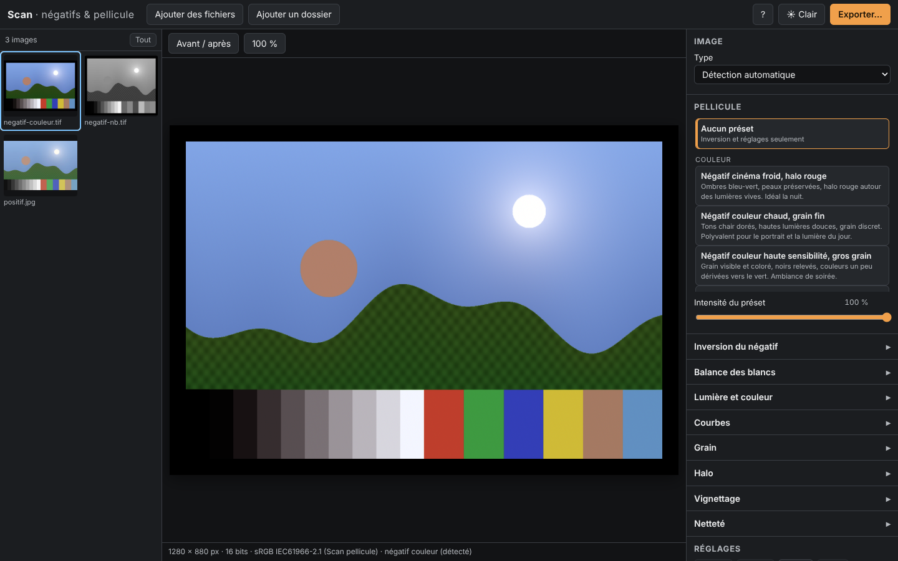

# Scan — négatifs et émulation de pellicule

Web app qui transforme des scans de négatifs et des photos en images au rendu pellicule.
**Tout se passe dans le navigateur** : aucun serveur, aucune image envoyée sur le réseau,
aucune clé d'API.



- **Import** TIFF (8/16 bits, RVB ou gris, non compressé, LZW, Deflate, PackBits, bandes ou
  tuiles) et JPEG, en lot : glisser-déposer de fichiers ou de dossiers (sous-dossiers
  compris), boutons « Ajouter des fichiers / un dossier » en repli.
- **Inversion** des négatifs couleur (masque orange mesuré sur le bord non exposé) et noir et
  blanc, détection automatique du type d'image, niveaux et balance automatiques.
- **10 présets** de film décrits en JSON, curseur d'intensité, avant/après maintenu.
- **Réglages avancés** repliables : balance des blancs, exposition, contraste, saturation,
  courbes RVB et par canal, grain, halo, vignettage, netteté.
- **Cadrage** : rotation par quarts de tour, miroir, rognage par bord, et **recadrage
  automatique** qui retire le bord non exposé du film. L'orientation des TIFF est respectée.
- **Pipette** de balance des blancs (cliquer sur une zone qui devrait être grise) et
  **histogramme** RVB avec le pourcentage de noirs bouchés et de blancs brûlés.
- **Aperçu temps réel WebGL2**, en basse définition pendant un glissement ; l'image suivante
  de la grille est préchargée.
- **Historique** (annuler/rétablir), copier-coller de réglages, préset sur une sélection,
  présets personnels, export/import des réglages en JSON. Tout est sauvegardé dans IndexedDB.
- **Export** JPEG, PNG ou TIFF 16 bits (profil sRGB embarqué), en lot dans un ZIP généré en
  flux, avec modèle de nommage, 2 à 4 travaux en parallèle, annulation et reprise après
  rechargement de la page.

## Installation et lancement

Node.js 20 ou plus récent.

```bash
npm install
```

```bash
npm run dev
```

Puis ouvrir http://localhost:5173. Le bouton « Images d'exemple » charge trois scans de test.

Version de production (fichiers statiques dans `dist/`, servables par n'importe quel
hébergement statique) :

```bash
npm run build
```

```bash
npm run preview
```

Navigateurs : Chromium (Chrome, Edge) recommandé ; Firefox et Safari récents fonctionnent
(WebGL2, `OffscreenCanvas` dans les workers). Sans File System Access API, le ZIP est
assemblé en mémoire puis téléchargé, et les fichiers doivent être réimportés après un
rechargement (leurs réglages sont retrouvés).

## Utilisation

1. Glissez vos scans (ou un dossier) dans la fenêtre.
2. Le type d'image est détecté (« négatif couleur (détecté) » sous l'aperçu). Si besoin,
   changez-le dans **Image › Type**.
3. Choisissez un préset de **Pellicule**, ajustez l'**intensité**. Maintenez **Avant / après**
   (ou la touche `B`) pour comparer.
4. Pour aller plus loin, ouvrez les panneaux avancés. Chaque curseur a un bouton ↺ ; un
   double-clic remet la valeur par défaut. Les effets (grain, halo…) suivent le préset
   tant que vous ne les modifiez pas.
5. **Exporter…** (`Ctrl+E`) : image affichée, sélection ou toutes les images.

Raccourcis : `?` dans l'application.

| Raccourci | Action |
| --- | --- |
| `B` maintenu | Original |
| `Z` | 100 % / ajusté |
| `Ctrl+Z`, `Ctrl+Maj+Z` | Annuler, rétablir |
| `Ctrl+Maj+C`, `Ctrl+Maj+V` | Copier, coller les réglages (sur la sélection) |
| Flèches, `Maj`, `Espace`, `Ctrl+A` dans la grille | Navigation et sélection |
| `Échap` | Quitter la pipette |

Pour retirer le bord noir du film après inversion : panneau **Cadrage › Recadrage auto**.
Pour corriger une dominante : **Pipette gris neutre** puis clic sur un gris, un blanc ou un
mur neutre (`Échap` pour annuler).

Astuce pellicule : sélectionnez toutes les vues d'une même bobine, ouvrez **Inversion du
négatif** et cliquez **Même inversion pour la sélection** pour leur appliquer le même
masque et les mêmes niveaux.

## Tests

Tests unitaires (Vitest, 62 tests) : décodeur/encodeur TIFF (dont l'orientation), LZW,
profils ICC, estimation du masque, recadrage automatique, cadrage, inversion, courbes,
présets, pipeline de rendu, pipette, nommage, historique, réglages JSON.

```bash
npm test
```

Parcours complets (Playwright, Chromium avec WebGL2 logiciel) : import de 50 images,
latence de l'aperçu, avant/après, annuler/rétablir, persistance, ZIP de 20 images,
TIFF 16 bits, JSON, copier-coller, accessibilité, reprise d'export après rechargement,
cohérence aperçu GPU / export CPU, recadrage auto et rotation à l'export, pipette,
histogramme, préchargement, import de dossier, glisser-déposer.

```bash
npm run test:e2e
```

Le test de mémoire sur un scan de 40 Mpx est ignoré tant que la fixture n'existe pas
(≈ 125 Mo, non versionnée) :

```bash
npm run fixtures:big
```

```bash
npx playwright test e2e/big.spec.ts
```

### Mesures (conteneur Linux, 4 cœurs, WebGL logiciel SwiftShader)

| Mesure | Résultat |
| --- | --- |
| 50 images importées → 50 miniatures | ≈ 17 s, aucune tâche longue (> 50 ms) sur le thread principal |
| Curseur d'intensité → nouvelle image (scan de 6 Mpx) | médiane 55–90 ms selon les exécutions |
| ZIP de 20 images | ≈ 14 s, archive valide, JPEG lisibles |
| Scan 40 Mpx : aperçu / export JPEG | ≈ 6 s / ≈ 27 s |
| Scan 40 Mpx : tas JS du thread principal | 47 Mo (l'image pleine résolution ne vit que dans un worker) |
| Écart aperçu GPU / export CPU | ≤ 1,2 / 255 sur des moyennes de zones |

Le rendu pleine définition de l'aperçu prend 0,3–0,45 s en WebGL *logiciel* ; sur un vrai
GPU il est de quelques millisecondes.

## Jeu d'essai

`fixtures/` contient des scans synthétiques générés par `scripts/gen-fixtures.ts` (un
négatif est simulé physiquement : densité = densité du support + γ·log E, avec un masque
orange et un bord non exposé) :

| Fichier | Contenu |
| --- | --- |
| `negatif-couleur.tif` | négatif couleur 16 bits, Deflate, profil sRGB, bord non exposé |
| `negatif-nb.tif` | négatif N&B 16 bits en niveaux de gris, LZW |
| `negatif-couleur-8bits.tif` | négatif couleur 8 bits non compressé |
| `positif.jpg` | même scène en positif |
| `moyenne-6mpx.tif` | 6 Mpx (généré à la demande, non versionné) |
| `big/scan-40mpx.tif` | 40 Mpx (`npm run fixtures:big`, non versionné) |

```bash
npm run fixtures
```

## Ajouter un préset

Les présets intégrés sont des fichiers JSON dans `src/presets/`, chargés automatiquement
au build (`import.meta.glob`). Créez `src/presets/mon-film.json` :

```json
{
  "id": "couleur-dore-doux",
  "name": "Négatif couleur doré, doux",
  "description": "Lumière de fin de journée, contraste bas.",
  "category": "couleur",
  "temperature": 18, "tint": 2,
  "contrast": -6, "saturation": 4, "fade": 0.03,
  "mixer": [1.03, -0.01, -0.02, 0.0, 1.0, 0.0, -0.02, 0.02, 1.0],
  "curves": {
    "rgb": [[0, 0.02], [0.5, 0.52], [1, 0.97]],
    "b": [[0, 0.03], [1, 0.95]]
  },
  "split": { "shadowsHue": 200, "shadowsAmount": 0.05, "highlightsHue": 40, "highlightsAmount": 0.1 },
  "grain": { "amount": 0.2, "size": 1.0, "roughness": 0.45, "color": 0.15, "luminance": 0.6 },
  "halation": { "amount": 0.1, "radius": 0.4, "threshold": 0.8 },
  "vignette": { "amount": 0.12, "midpoint": 0.55, "feather": 0.6 },
  "sharpen": { "amount": 0.2 }
}
```

| Champ | Rôle | Plage |
| --- | --- | --- |
| `id` | identifiant unique : minuscules, chiffres, tirets | — |
| `name`, `description` | textes affichés ; noms **descriptifs**, pas de marques | — |
| `category` | `couleur`, `diapositive`, `noir et blanc` | — |
| `monochrome` | poids R, V, B du passage en N&B (filtre coloré) ; absent = couleur | ex. `[0.36, 0.52, 0.12]` |
| `mixer` | matrice 3×3 de mélange des canaux (par lignes), en linéaire | ≈ ±0,1 autour de l'identité |
| `temperature`, `tint` | balance des blancs | −100…100 |
| `contrast`, `saturation` | contraste en S, saturation | −100…100 |
| `fade` | relèvement des noirs | 0…0,3 |
| `curves` | courbes `rgb`, `r`, `g`, `b` : points `[entrée, sortie]` entre 0 et 1 | — |
| `split` | virage partagé : teinte (degrés) et force des ombres / hautes lumières | 0…360, 0…1 |
| `grain` | `amount`, `size` (0,5…4, proportionnelle au cadre), `roughness`, `color`, `luminance` (concentration dans les tons moyens) | 0…1 |
| `halation` | halo rouge autour des hautes lumières : `amount`, `radius`, `threshold` | 0…1 |
| `vignette` | `amount` (négatif = éclaircit), `midpoint`, `feather` | −1…1, 0…1 |
| `sharpen` | `amount` | 0…2 |

Les champs absents prennent une valeur neutre ; les valeurs hors plage sont bornées. Le
test `tests/pipeline.test.ts` vérifie que chaque préset se charge, que les identifiants
sont uniques et qu'aucun nom de marque n'est utilisé.

Sans toucher au code, **Enregistrer comme préset** (panneau Réglages) crée un préset
personnel à partir des réglages de l'image, stocké dans IndexedDB.

## Architecture

Voir [PLAN.md](PLAN.md). En bref :

- `src/core/` — logique pure et testée : TIFF, ICC, analyse, réglages, présets, compilation
  des réglages en paramètres de rendu, pipeline CPU de référence.
- `src/gl/` — rendu WebGL2 en trois passes (`shaders/*.glsl`), miroir exact du pipeline CPU
  (même bruit déterministe, même carte de halo calculée sur le proxy).
- `src/workers/` — décodage, miniatures, aperçu et export dans des workers ; un pool avec
  budget mémoire évite de décoder trop de gros scans à la fois.
- `src/export/` — file d'export persistante, ZIP en flux (fflate).
- `src/state/` — store (zustand), historique, persistance IndexedDB (idb-keyval).
- `src/ui/` — composants React.

Gestion des couleurs : espace de travail sRGB linéaire ; les profils ICC matrice/TRC des
TIFF (Adobe RGB, ProPhoto, gamma…) sont convertis ; les JPEG sont convertis en sRGB par le
navigateur ; l'aperçu est un canvas sRGB que le navigateur adapte à l'écran ; aucune
quantification 8 bits avant le shader (textures demi-flottantes).
